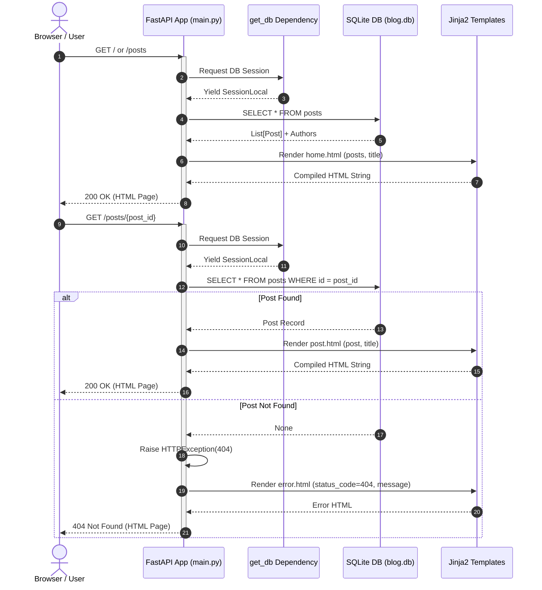

# FastAPI Blog

A modern, hybrid web application and RESTful API built with **FastAPI**, **SQLAlchemy 2.0**, and **Jinja2** templates. It features server-side rendered pages with Bootstrap 5 (including custom themes and dark-mode support) alongside validated REST API endpoints with interactive OpenAPI documentation.

## Overview

`fastapi-blog` combines the speed and developer ergonomics of FastAPI with the flexibility of both server-side rendered (SSR) templates and a JSON REST API:

- **Frontend / SSR UI**: Responsive Bootstrap 5 interface with a dark/light/auto mode switcher, custom Google fonts (`Montserrat` and `Nunito`), and modular Jinja2 templates.
- **Backend / REST API**: Type-safe endpoints powered by Pydantic v2 schemas and SQLAlchemy 2.0 mapped models.
- **Smart Exception Handling**: Distinguishes between browser traffic (rendering styled HTML error pages) and API traffic (returning RFC-compliant JSON error details).


## Key Features

- **Dual-Mode Serving**: Browse posts via clean HTML views or integrate programmatically using `/api` JSON routes.
- **Interactive Documentation**: Instant Swagger UI (`/docs`) and ReDoc (`/redoc`) powered by OpenAPI.
- **ORM & Database Layer**: SQLite persistence via SQLAlchemy 2.0 declarative models with foreign key constraints and automatic schema creation.
- **Responsive Layout & Theming**: Bootstrap 5 with client-side theme switcher stored in `localStorage`.
- **Dynamic Asset Handling**: Static assets mounted at `/static` and user-uploaded content mounted at `/media`.
- **Fast Package Management**: Configured with `uv` and `pyproject.toml` for blazing fast environment management.

## System Architecture & Sequence Diagrams
### 1. Web Client Request & Server-Side Rendering
This diagram illustrates how browser clients request pages, how FastAPI resolves database queries via dependencies, and how Jinja2 renders templates or error pages.

### 2. REST API Request Lifecycle & Error Handling
This diagram depicts API clients creating users and publishing posts with validation rules and error routing.
```mermaid
sequenceDiagram
    autonumber
    actor Client as API Client / Frontend
    participant App as FastAPI App
    participant Schema as Pydantic Validation
    participant DB as SQLite DB (blog.db)
    participant Handler as Exception Handlers

    %% User Creation
    Client->>App: POST /api/users {username, email}
    activate App
    App->>Schema: Validate UserCreate schema
    alt Invalid Payload
        Schema-->>Handler: RequestValidationError
        Handler-->>Client: 422 Unprocessable Entity (JSON)
    else Payload Valid
        App->>DB: SELECT user WHERE username OR email exists
        alt Duplicate Username or Email
            DB-->>App: Existing Record
            App->>Handler: HTTPException(400, "Username/Email already exists")
            Handler-->>Client: 400 Bad Request {"detail": "..."}
        else New User
            App->>DB: INSERT INTO users ...
            DB-->>App: New User (id, username, email)
            App->>Schema: Serialize with UserResponse
            Schema-->>Client: 201 Created (JSON)
        end
    end
    deactivate App

    %% Post Creation
    Client->>App: POST /api/posts {title, content, user_id}
    activate App
    App->>DB: SELECT user WHERE id = user_id
    alt Author Not Found
        DB-->>App: None
        App->>Handler: HTTPException(404, "User not found")
        Handler-->>Client: 404 Not Found {"detail": "User not found"}
    else Author Exists
        App->>DB: INSERT INTO posts ...
        DB-->>App: New Post (id, date_posted, user_id)
        App->>Schema: Serialize with PostResponse
        Schema-->>Client: 201 Created (JSON)
    end
    deactivate App
